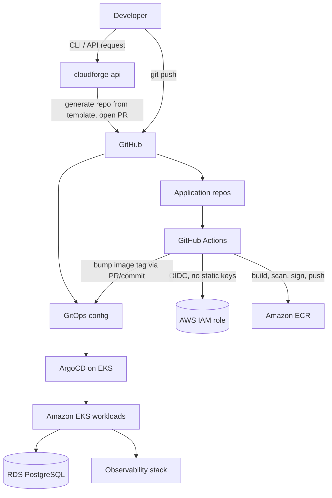
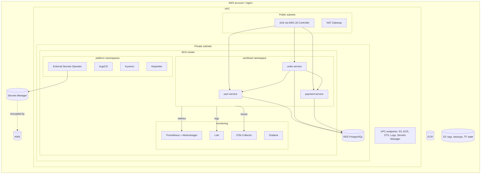

# CloudForge Architecture Overview

CloudForge is an Internal Developer Platform (IDP) on AWS. A developer requests a
service (via API or CLI); the platform generates a repository from a golden-path
template, CI builds/scans/pushes the image, a GitOps commit declares the desired
state, and ArgoCD reconciles it onto EKS.

Guiding principle: **golden paths over custom snowflakes.** Every component must
have a documented reason to exist (see `technology-decisions.md` and `../adr/`).

## 1. System context



## 2. Component diagram (per environment)



## 3. Delivery flow

```mermaid
sequenceDiagram
  participant D as Developer
  participant G as GitHub
  participant A as GitHub Actions
  participant E as ECR
  participant O as GitOps config
  participant C as ArgoCD
  participant K as EKS
  D->>G: push / PR
  A->>A: lint, unit tests, SAST, dep scan, gitleaks
  A->>A: docker build, Trivy scan, SBOM
  A->>E: push image (OIDC role, immutable tag = git SHA)
  A->>O: update image tag (dev auto; staging/prod via PR + approval)
  C->>O: poll/webhook, detect change
  C->>K: sync desired state
  K-->>C: health status
  C-->>D: status (UI, notifications)
```

## 4. Request path and tracing

`Client -> ALB -> order-service -> (user-service, payment-service) -> PostgreSQL`.
The ALB/Ingress acts as the entry point ("API gateway") in v1; a dedicated gateway
is out of scope (see Future Improvements). W3C trace context propagates across
services; the OTel Collector exports traces to a backend chosen in Phase 9.

## 5. Environments and isolation

Target design: **one VPC and one EKS cluster per environment**, separate Terraform
state per environment, shared modules. See ADR-009 for the cost-conscious operating
mode (only `dev` runs routinely; `staging`/`production` are applied for demos and
destroyed afterwards).

| Concern | dev | staging | production |
|---|---|---|---|
| Purpose | Daily work, demos | Pre-prod validation | Prod-like reference |
| Node capacity | Spot, small | Spot + on-demand mix | On-demand baseline + Spot burst |
| RDS | Single-AZ, small | Single-AZ | Multi-AZ, deletion protection |
| NAT | Single NAT | Single NAT | NAT per AZ |
| Deploy trigger | Auto on merge | PR to GitOps | PR + manual approval |
| Always on | No | No | No (portfolio) |

## 6. Namespaces (per cluster)

Controllers: `argocd`, `kyverno`, `external-secrets`, `karpenter`. Platform apps:
`platform` (cloudforge-api), `monitoring`. Workloads run in a namespace named after
the environment (`dev`, `staging`, `production`) so manifests and dashboards stay
consistent between multi-cluster and "lite" single-cluster mode.

## 7. Repository strategy

| Repo | Contents | Phase 1 location |
|---|---|---|
| `cloudforge` (this) | Terraform, platform manifests, API, CLI, docs | root |
| App repos | Generated per service from the template | `services/*` (monorepo for the demo) |
| GitOps config | Desired state consumed by ArgoCD | `gitops/` (split into its own repo in Phase 8) |

A separate GitOps repo is best practice (distinct access control, no CI loops); it
starts as a directory to keep early phases simple.
